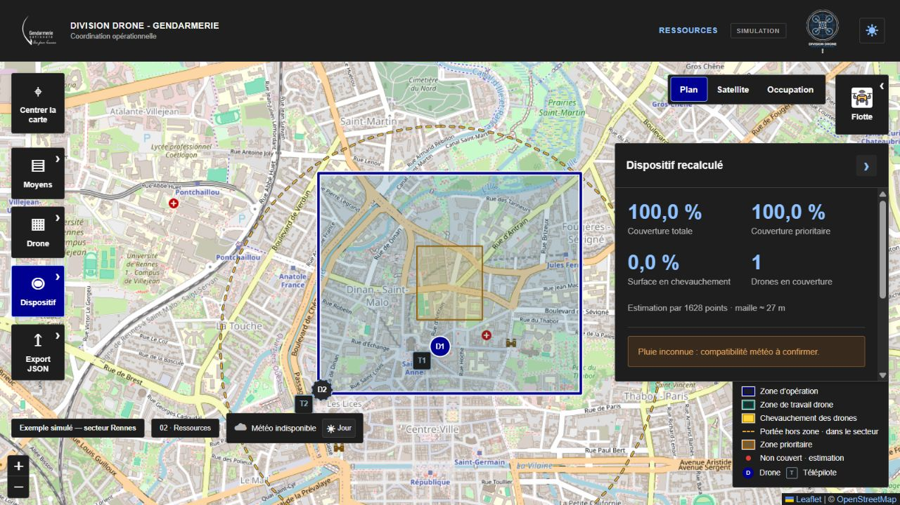

<div align="center">
  

  <h1>Division Drone</h1>

  <p><strong>Planification et coordination simulée d’une flotte de drones</strong></p>
  <p>🥇 1ʳᵉ place · Hackathon drones de la Gendarmerie nationale · UPSSITECH</p>

  <p>
    <a href="https://drone-planning.vercel.app/"><strong>Ouvrir la démonstration</strong></a>
    · <a href="#démarrage-rapide">Installation</a>
    · <a href="#moteur-de-planification">Algorithmes</a>
    · <a href="#documentation">Documentation</a>
  </p>
  <p><a href="README.md">English</a> · <strong>Français</strong></p>
</div>



*Mission fictive de Rennes : un drone en couverture et une unité en réserve. Fond cartographique © [contributeurs OpenStreetMap](https://www.openstreetmap.org/copyright).*

## Le projet

Développé en équipe en **9 heures**, le **14 octobre 2026**, lors du hackathon organisé par la Région de gendarmerie d’Occitanie, Division Drone répond à un problème concret : **comment répartir des moyens aériens sur une zone, en donnant la priorité aux secteurs critiques et en limitant les chevauchements ?**

L’opérateur dessine son périmètre, indique les contraintes de mission et les ressources disponibles, puis obtient une proposition de dispositif qu’il peut ajuster sur la carte. Le prototype accompagne la préparation, la comparaison des moyens et la conduite d’une **opération simulée**.

Cette version est une application web pour ordinateur, exécutée dans le navigateur. Elle ne pilote aucun drone réel. Ce README décrit les fonctionnalités présentes sur la branche **`main`**.

## Fonctionnalités

| Domaine | Ce que permet l’application |
| --- | --- |
| **Cartographie** | Dessiner la zone d’opération et les zones prioritaires ; naviguer entre les fonds Plan, Satellite et Occupation. |
| **Planification** | Estimer le nombre de drones et de télépilotes, proposer les positions et mesurer la couverture totale, prioritaire et les chevauchements. |
| **Contraintes de mission** | Prendre en compte les scénarios TP1/TP2, l’environnement rural ou urbain, la pluie, le jour et la nuit, les stocks et les limites saisies par l’utilisateur. |
| **Gestion des moyens** | Adapter les quantités disponibles, consulter ou enrichir le catalogue, conserver des unités en réserve et recalculer le dispositif. |
| **Simulation** | Déplacer drones et télépilotes, ajuster les secteurs et altitudes, détecter les conflits, simuler un retour ou un arrêt d’urgence. |
| **Sauvegarde** | Exporter une mission en JSON et la réimporter pour retrouver sa géométrie, ses ressources et son état. |

Les secteurs de travail sont découpés à la zone d’opération. La carte distingue les zones prioritaires, les surfaces couvertes par plusieurs drones et les lacunes de couverture. Les drones en réserve restent visibles sans contribuer à la couverture.

## Essayer la démonstration

La [démonstration en ligne](https://drone-planning.vercel.app/) est accessible sans compte.

**Parcours immédiat :** sélectionner **Reprendre une mission → Charger la mission de démonstration**, puis **Recalculer avec les ressources réelles**. Un scénario fictif de Rennes permet d’explorer les ressources, la carte et la simulation sans créer de fichier.

Pour préparer sa propre mission :

1. Ouvrir **Préparer une mission** et renseigner le nom, la date, l’heure et le scénario.
2. Rechercher une adresse française ou saisir des coordonnées WGS84 dans l’ordre **longitude, latitude**. La carte est initialement centrée sur Mirepoix.
3. Dessiner la zone d’opération, puis les éventuelles zones prioritaires. Fermer chaque polygone sur son premier sommet ou avec **Terminer**.
4. Lancer **Calculer l’estimation**, examiner la couverture et ajuster les secteurs proposés.
5. Préparer l’opération, renseigner les moyens réellement disponibles et recalculer. Les conflits doivent être résolus avant le lancement simulé.
6. Ajuster le dispositif et utiliser **Export JSON** pour conserver la mission.

**La mission courante reste en mémoire : exporter avant de recharger ou de quitter la page.** Seuls le thème et les préférences sont mémorisés automatiquement sur l’appareil.

## Moteur de planification

Le moteur recherche un **compromis entre couverture, priorités et nombre de drones**. La version actuelle combine plusieurs stratégies de placement ; elle va au-delà de l’approche gloutonne initiale.

### Du périmètre au dispositif

1. **Filtrer les moyens admissibles** selon les modèles, les scénarios, la météo, les stocks et les contraintes déclarées.
2. **Échantillonner la zone** sur une grille de points. Les points des zones prioritaires reçoivent un poids de **4**, contre **1** pour les autres.
3. **Comparer plusieurs dispositions** pour des effectifs croissants : construction gloutonne, partitions en *k-centres* et amélioration locale des positions. Le raffinement complet est appliqué jusqu’à **12 drones** ; des dispositions en réseau hexagonal sont aussi évaluées pour les grands dispositifs.
4. **Sélectionner un compromis de couverture** parmi les dispositions non dominées. Le moteur recherche d’abord **85 % de couverture totale** et **92 % de couverture prioritaire**, lorsque les moyens et les contraintes le permettent. Il évalue ensuite le gain par drone supplémentaire, avec un seuil par défaut plafonné à **3 points de couverture pondérée**, adapté à la baisse sur les très grandes zones.
5. **Finaliser les moyens** : retirer les drones redondants, rééquilibrer les modèles standard interchangeables selon les stocks et attribuer les télépilotes.
6. **Attribuer les altitudes** à partir d’un graphe de chevauchement et d’une recherche DSatur bornée, en respectant les plafonds et la séparation verticale. Une impossibilité est remontée sous forme d’avertissements et de conflits.

Il s’agit d’une **heuristique déterministe**, sans garantie d’optimum global ni d’effectif minimal. Les pourcentages reposent sur un échantillonnage ; les objectifs de couverture peuvent rester inatteignables. Le moteur expose également les compromis calculés dans `result.tradeoff` ; leur sélecteur graphique expérimental n’est pas intégré à `main`.

Sources : [moteur de planification](src/engines/planning/index.ts), [géométrie](src/engines/geometry) et [tests de l’optimiseur](tests/planning/optimizer.test.mjs).

### Scénarios du prototype

| Scénario | Portée maximale | Plafond rural | Plafond urbain |
| --- | --- | --- | --- |
| TP1 en vue | 500 m | 120 m | 120 m |
| TP1 hors vue | 1 000 m | 50 m | 80 m |
| TP2 hors vue | 2 000 m | 120 m | 120 m |

Le mode mixte adapte le rayon au besoin et privilégie TP1 à gain équivalent. Les paramètres initiaux sont une séparation verticale de **30 m** et un chevauchement maximal de **20 %**, modifiables dans les paramètres.

Ces valeurs constituent les règles de simulation du hackathon. La nuit ou sous la pluie, la politique du prototype retient exclusivement le **DJI Matrice 4T**, y compris en présence de modèles personnalisés. Cette règle ne constitue ni une validation réglementaire ni une certification constructeur pour le vol sous la pluie ; les caractéristiques sourcées figurent dans les [fiches drones](docs/DRONE_SPECS.md).

## Démarrage rapide

**Prérequis :** Node.js **22.18 ou supérieur**, npm et Git. Les tests utilisent le support natif de TypeScript de Node.js.

```sh
git clone https://github.com/MariusPinard/hackathon-gendarmerie-drones.git
cd hackathon-gendarmerie-drones
npm ci
npm run dev
```

Ouvrir l’adresse indiquée par Vite, généralement **http://localhost:5173**. Les modules TypeScript doivent être servis par Vite ; l’ouverture directe de `index.html` ne suffit pas.

| Commande | Rôle |
| --- | --- |
| `npm run dev` | Serveur de développement avec rechargement à chaud. |
| `npm run typecheck` | Vérification des types TypeScript. |
| `npm test` | Suite de tests avec `node:test`. |
| `npm run build` | Vérification des types puis génération du site dans `dist/`. |
| `npm run preview` | Prévisualisation locale du dernier build. |

## Architecture

**React 19 · TypeScript strict · Vite · Leaflet**

Les moteurs de géométrie, de planification et d’opérations sont séparés du rendu React. La branche `main` est un frontend autonome, sans backend métier ni SDK de commande de drones.

```text
src/
├── app/                  Contexte de mission et horloge de simulation
├── pages/                Accueil, import, planification, ressources, conduite
├── components/           Carte Leaflet, panneaux, flotte et formulaires
├── engines/
│   ├── geometry/         Projection, validation, intersections et couverture
│   ├── planning/         Estimation, placement, modèles et altitudes
│   └── operations/       Conflits, modifications et transitions simulées
├── services/             Météo, géocodage, occupation, JSON et préférences
├── types/                Contrats TypeScript
├── data/                 Catalogue standard et mission de démonstration
└── styles/               Mise en page et thèmes
public/                   Images et données d’occupation précalculées
tests/                    Tests unitaires et parcours métier
docs/                     Documentation fonctionnelle et technique
```

### Données et services

| Source | Usage |
| --- | --- |
| OpenStreetMap | Fond cartographique Plan. |
| IGN | Orthophotographies en France et géocodage d’adresses françaises avec les données BAN. |
| Open-Meteo | Prévision de pluie au lieu et au créneau choisis. |
| Calcul astronomique local | Détermination du jour et de la nuit, même sans prévision disponible. |
| Données d’occupation | Analyse précalculée de Mirepoix, complétée si besoin par un service externe compatible. |

Le parcours standard ne nécessite pas de clé API. Les services distants dépendent du réseau ; une météo indisponible reste **inconnue**, sans être assimilée à un temps sec. Le vent et le zoom sont affichés dans le catalogue mais ne participent pas à l’optimisation.

Les fichiers de mission restent dans le navigateur jusqu’à leur export local. Les requêtes de carte, d’adresse et de météo transmettent aux fournisseurs le secteur consulté ou la recherche saisie.

### Occupation du terrain — configuration facultative

La carte précalculée de **Mirepoix — INSEE 09194** est fournie dans [`public/occupancy/commune-09194.json`](public/occupancy/commune-09194.json). Elle permet d’afficher les catégories de terrain et les indications de décollage sans service d’analyse en direct.

Pour analyser d’autres secteurs, utiliser un service externe exposant **`POST /api/v1/occupancy/tile`**. Ce service n’est pas livré dans la branche `main`. Son URL peut être définie dans `.env.local` :

```dotenv
VITE_OCCUPANCY_API_URL=http://127.0.0.1:8000
```

En développement, cette adresse locale est utilisée par défaut. En production, sans URL configurée, seules les données précalculées sont disponibles. Redémarrer Vite après un changement et définir la variable avant de construire une version statique. Le service doit autoriser l’origine du frontend via CORS ; utiliser HTTPS avec une application servie en HTTPS.

L’analyse est déclenchée par **Lancer le calcul**, avec au plus **24 tuiles par lancement**, **2 requêtes simultanées** et un cache de session. Ces indications nécessitent une vérification sur le terrain. Elles ne sont pas utilisées pour rechercher automatiquement les positions des télépilotes dans `main`.

## Sauvegardes et préférences

- **Mission :** import/export JSON, `schemaVersion: "1.0"`, comprenant zones, catalogue, météo, ressources, positions et états. L’import valide les données puis passe par la vérification des ressources.
- **Préférences :** catalogue par défaut, séparation verticale et chevauchement conservés dans le stockage local du navigateur, avec le thème.
- **Urgence :** les exports récents peuvent inclure l’instantané permettant de restaurer le dispositif après un atterrissage d’urgence simulé.

Un [exemple de mission](src/data/exampleMission.json) et la [description du format JSON](docs/FORMAT_JSON.md) sont fournis dans le dépôt.

## Tests et qualité

```sh
npm test
npm run build
git diff --check
```

La suite couvre notamment la géométrie, les stratégies de placement, les priorités, les stocks, les scénarios TP1/TP2, la météo, les altitudes, les réserves, les conflits, l’import/export et les services externes. Des tests de parcours relient estimation, ressources insuffisantes, lancement, modification, retour et urgence.

Les tests importent directement les sources TypeScript. Le build effectue aussi la vérification des types ; les [contrôles visuels](docs/VALIDATION.md) complètent ces vérifications pour la carte et les interactions.

## Déploiement

```sh
npm run build
```

Publier **tout le contenu de `dist/`** sur un hébergement statique HTTP(S), en conservant les répertoires `image/` et `occupancy/`. La configuration actuelle attend un déploiement à la racine du domaine.

Pour Vercel : commande de build **`npm run build`**, répertoire de sortie **`dist`** et version de Node compatible avec le prérequis du projet. Le service d’occupation, s’il est utilisé, se déploie séparément. Les variables `VITE_` sont intégrées au code public du frontend et ne doivent contenir aucun secret. `npm run preview` sert à la vérification locale du build.

## Périmètre et limites

- **Simulation :** pas de télémétrie, de commande matérielle, de trajectoires de vol physiques ni de liaison radio réelle. Les contrôles d’altitude et les scénarios ne remplacent pas une validation opérationnelle.
- **Couverture :** projection locale, rayons simplifiés et métriques échantillonnées ; le moteur ne modélise pas le relief, le champ de vision des capteurs ou la propagation radio.
- **Télépilotes :** drone et télépilote sont initialement placés au même endroit. La couche d’occupation apporte une aide visuelle distincte du calcul de placement.
- **Géométrie et import :** emprise limitée à 50 km de côté, hors régions polaires et franchissement de l’antiméridien ; au plus 20 zones prioritaires, 300 sommets distincts par anneau et 2 Mo par fichier JSON.
- **Effectifs :** aucune limite fixe à 32 drones ; le coût de calcul augmente avec la taille du dispositif, selon les stocks, les placements admissibles et les contraintes saisies.
- **Persistance :** pas de sauvegarde automatique ou serveur de la mission ; conserver les fichiers JSON exportés pour reprendre le travail.

## Documentation

| Document | Contenu |
| --- | --- |
| [Démonstration](docs/DEMO.md) | Parcours de présentation et manipulations de la carte. |
| [Exigences](docs/REQUIREMENTS.md) | Cahier des charges fonctionnel du prototype. |
| [Architecture](docs/ARCHITECTURE.md) | Organisation des composants et des moteurs. |
| [Contrats](docs/API_CONTRACT.md) | Interfaces et structures des moteurs. |
| [Format JSON](docs/FORMAT_JSON.md) | Sauvegardes, validation et compatibilité. |
| [Caractéristiques des drones](docs/DRONE_SPECS.md) | Capacités et sources constructeur. |
| [Validation](docs/VALIDATION.md) | Scénarios de contrôle fonctionnel et visuel. |
| [Intégration](docs/INTEGRATION.md) | Assemblage des composants du projet. |
| [Historique des algorithmes](docs/ALGORITHMES.md) | Description de l’approche initiale du hackathon. |
| [Identité visuelle](docs/LOGOS.md) | Sources et préparation des logos. |

Certains documents conservent l’état d’itérations antérieures du hackathon, notamment pour les seuils et l’approche gloutonne. La section [Moteur de planification](#moteur-de-planification) de ce README et les sources de `main` décrivent le moteur actuel.

## Équipe

Projet réalisé par l’équipe **UPSSITECH — Université de Toulouse**, lauréate du hackathon :

[Alec Bossard](https://www.linkedin.com/in/alec-bossard/) · [Arthus D.](https://www.linkedin.com/in/arthus-d-539497287/) · [Guilhem Carmouze](https://www.linkedin.com/in/guilhem-carmouze/) · [Marius Pinard](https://www.linkedin.com/in/marius-pinard-65a344241/) · [Théo Jeanmart](https://www.linkedin.com/in/th%C3%A9o-jeanmart-433717214/)

Merci à la **Région de gendarmerie d’Occitanie** pour l’organisation et la mise en situation autour de la coordination de moyens aériens.
