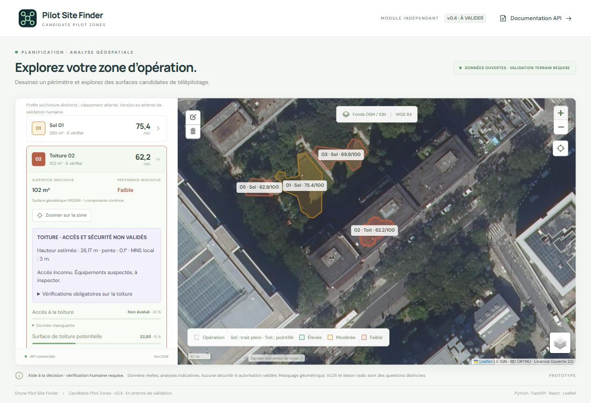
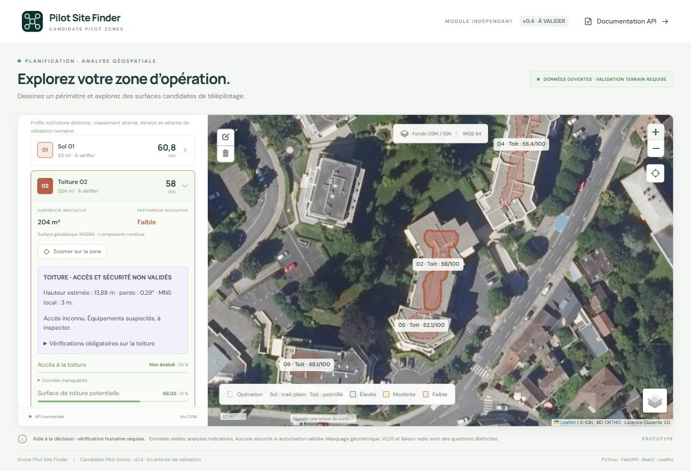
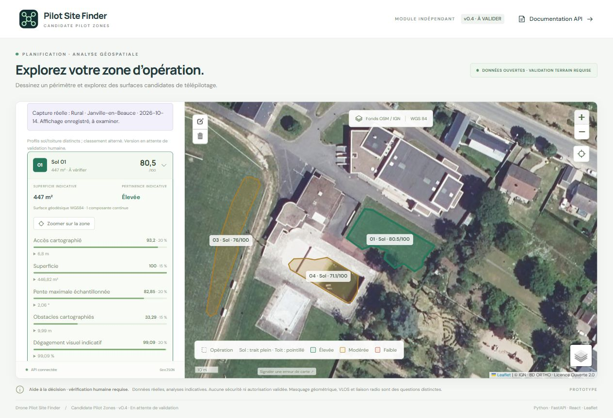
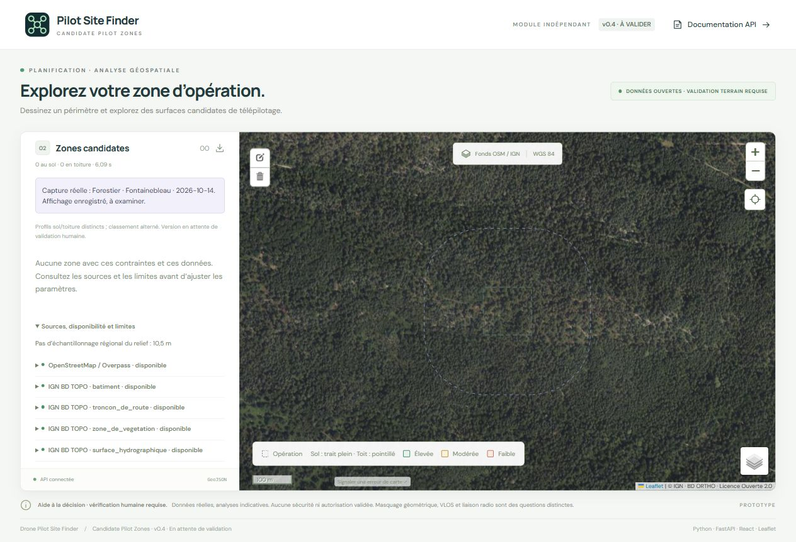
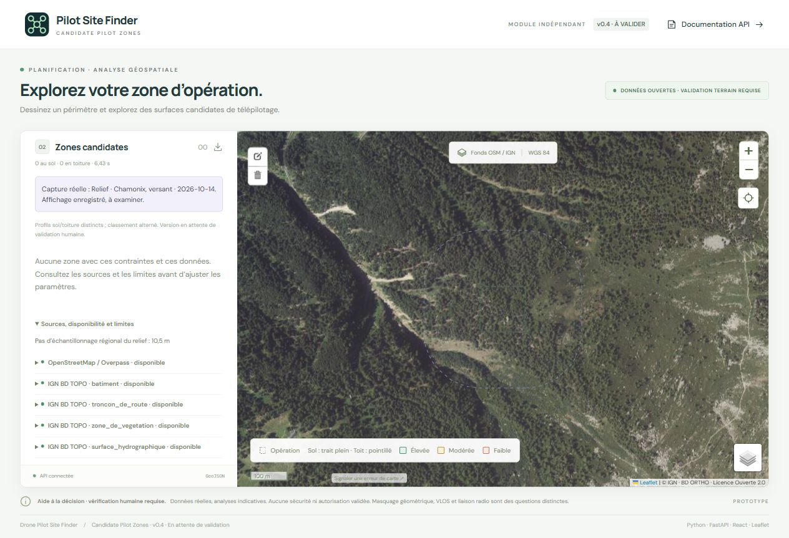
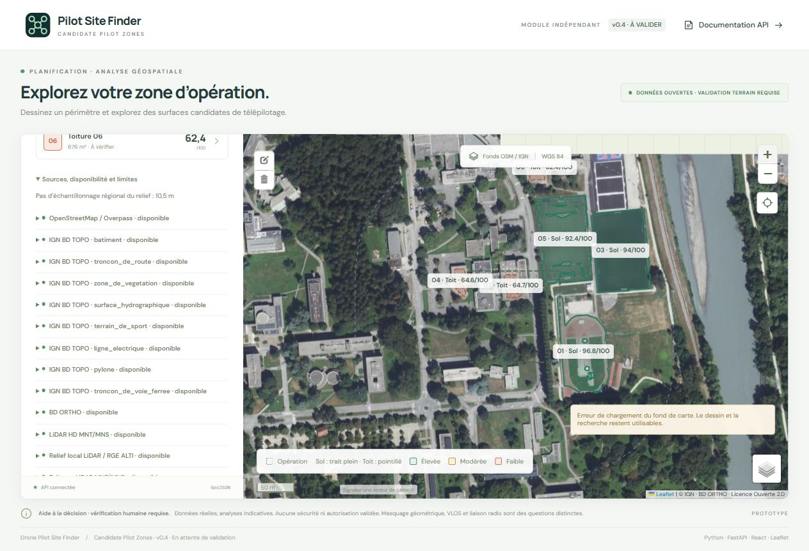

# V0.4 — Rapport des six environnements réels

**État : développement terminé, validation humaine en attente.** Publication autorisée sur une branche dédiée ; aucune intégration au hackathon. Les essais techniques et les captures ne constituent aucune validation de sécurité, d’accès ou d’autorisation.

Série enregistrée le `2026-10-14T11:27:33.067890+00:00` (UTC), le 14 octobre 2026 en France. Chaque analyse a appelé le backend HTTP réel ; aucun fournisseur fictif ni substitution de données n’a été utilisé. Les réponses complètes conservent mesures, géométries, licences, attributions, dates disponibles et limites.

## Examiner les résultats

Double-cliquez sur `Visualiser-V0.4.cmd` à la racine du dépôt. Dans l’interface, ouvrez **Examiner les six environnements · V0.4**, choisissez le cas, puis **Afficher l’analyse enregistrée**. Le backend n’est pas nécessaire pour consulter ces captures. Le fond de carte exige une connexion. Cliquez sur un polygone ou une fiche, puis **Zoomer sur la zone** ; le toit a un bord pointillé, le sol un bord plein. La couleur représente un score indicatif, jamais une validation.

**Préparer une nouvelle analyse** charge exactement le périmètre, les options et le nombre demandé du cas. Le bouton de recherche acquiert alors les données via le backend. La rétention/rejet ne vaut que pour l’inspection et figure dans l’export.

## Synthèse de la série finale

| Environnement | Sol | Toitures | Temps HTTP | État des données |
| --- | ---: | ---: | ---: | --- |
| Urbain dense · Paris, BnF | 3 | 3 | 17,01 s | sources acquises |
| Résidentiel · Avon | 2 | 4 | 17,71 s | sources acquises |
| Rural · Janville-en-Beauce | 4 | 0 | 14,30 s | données partielles |
| Forestier · Fontainebleau | 0 | 0 | 6,10 s | aucun candidat |
| Relief · Chamonix, versant | 0 | 0 | 6,44 s | aucun candidat |
| Mixte · Grenoble, campus STAPS | 3 | 3 | 12,89 s | sources acquises |

Les temps HTTP incluent transport et réponse. L’interface affiche le temps du moteur, légèrement inférieur. Les scores sol/toiture ont des profils distincts ; le classement alterne les types après classement au sein de chaque type. Ils ne sont ni des probabilités de sécurité, ni directement équivalents.

## Protocole et sources

Périmètre carré de 120 m de côté, extension de 150 m incluant l’intérieur, surface minimale 60 m², largeur 4 m, pente maximale au sol 12°, toiture 8°, recul du toit 3 m, grille régionale souhaitée 10 m et MNS local 3 m. Six candidats au maximum, douze portions de toit échantillonnées au maximum. L’altimétrie locale au sol est limitée à dix points par surface. Les requêtes sont séquentielles avec une pause ; les quotas publics restent variables.

Sources : OSM via Overpass (ODbL), IGN BD TOPO/BD ORTHO et MNT/MNS LiDAR HD via Géoplateforme (Licence Ouverte 2.0), repli RGE ALTI au sol, Panoramax avec licence/auteur/date par image. Dates d’acquisition d’orthophoto/LiDAR non renseignées par ces réponses ; date de consultation ≠ date des données. [Détails des sources](data-sources.md).

## Urbain dense · Paris, BnF

Centre du périmètre : 48.833200, 2.376800 (latitude, longitude). Temps HTTP : **17,01 s**. [Réponse GeoJSON complète](../frontend/public/validation/v0.4/urban.geojson).

| Zone | Type | Surface m² | Score /100 | Hauteur du toit m | Pente du toit ° |
| --- | --- | ---: | ---: | ---: | ---: |
| 01 · `zone-860fecdd18c1` | Sol | 279,51 | 75,40 | — | — |
| 02 · `roof-c4640fe877e8` | Toiture | 101,65 | 62,20 | 26,17 | 0,10 |
| 03 · `zone-68501a4c77a5` | Sol | 159,95 | 69,90 | — | — |
| 04 · `roof-cf77e30605e1` | Toiture | 231,32 | 61,60 | 20,17 | 0,14 |
| 05 · `zone-c565f17aab54` | Sol | 71,03 | 62,90 | — | — |
| 06 · `roof-2c0675d7f508` | Toiture | 442,64 | 51,60 | 8,88 | 5,52 |

Acquisition : OpenStreetMap / Overpass (1030 éléments), IGN BD TOPO · batiment (55 éléments), IGN BD TOPO · troncon_de_route (80 éléments), IGN BD TOPO · zone_de_vegetation (13 éléments), IGN BD TOPO · surface_hydrographique (1 éléments), IGN BD TOPO · terrain_de_sport (0 éléments), IGN BD TOPO · ligne_electrique (0 éléments), IGN BD TOPO · pylone (0 éléments), IGN BD TOPO · troncon_de_voie_ferree (11 éléments), BD ORTHO (1045504 éléments), LiDAR HD MNT/MNS (1681 éléments), Relief local LiDAR / RGE ALTI (24 éléments), Toitures LiDAR MNT/MNS (2265 éléments), Panoramax (360 éléments).

Aucune erreur d’acquisition signalée dans cette analyse. Cela ne prouve ni exhaustivité ni actualité.

Portions de toit : 12 échantillonnées sur 89 éligibles ; 0 sans données suffisantes. Dans cette révision, les clés historiques `roof_buildings_*` comptent des portions présélectionnées et non des bâtiments uniques.

Contrôles automatiques sur cette réponse : aucune incohérence détectée (schéma, géométrie, inclusion, somme des scores, accès toiture inconnu).

Observation visuelle / limite : Le moteur expose des portions mesurées de toits et de petites surfaces au sol. La capture montre un environnement très végétalisé dans la cour. Risque de faux positifs au sol sous la canopée : aucun examen terrain ne confirme leur dégagement. Les équipements du toit restent à inspecter.



## Résidentiel · Avon

Centre du périmètre : 48.413000, 2.724000 (latitude, longitude). Temps HTTP : **17,71 s**. [Réponse GeoJSON complète](../frontend/public/validation/v0.4/residential.geojson).

| Zone | Type | Surface m² | Score /100 | Hauteur du toit m | Pente du toit ° |
| --- | --- | ---: | ---: | ---: | ---: |
| 01 · `zone-ae5a17a68841` | Sol | 82,98 | 60,80 | — | — |
| 02 · `roof-3d7676b50ef5` | Toiture | 204,15 | 58,00 | 13,88 | 0,29 |
| 03 · `zone-5a5a95468f30` | Sol | 114,27 | 60,10 | — | — |
| 04 · `roof-364c2b96d761` | Toiture | 257,57 | 56,40 | 13,87 | 1,15 |
| 05 · `roof-9be4758f1a98` | Toiture | 82,65 | 52,10 | 13,95 | 0,29 |
| 06 · `roof-fc5c0ebcfcca` | Toiture | 86,16 | 48,10 | 13,64 | 0,00 |

Acquisition : OpenStreetMap / Overpass (460 éléments), IGN BD TOPO · batiment (293 éléments), IGN BD TOPO · troncon_de_route (91 éléments), IGN BD TOPO · zone_de_vegetation (5 éléments), IGN BD TOPO · surface_hydrographique (1 éléments), IGN BD TOPO · terrain_de_sport (0 éléments), IGN BD TOPO · ligne_electrique (2 éléments), IGN BD TOPO · pylone (0 éléments), IGN BD TOPO · troncon_de_voie_ferree (2 éléments), BD ORTHO (1044480 éléments), LiDAR HD MNT/MNS (1681 éléments), Relief local LiDAR / RGE ALTI (12 éléments), Toitures LiDAR MNT/MNS (1475 éléments), Panoramax (360 éléments).

Aucune erreur d’acquisition signalée dans cette analyse. Cela ne prouve ni exhaustivité ni actualité.

Portions de toit : 12 échantillonnées sur 26 éligibles ; 0 sans données suffisantes. Dans cette révision, les clés historiques `roof_buildings_*` comptent des portions présélectionnées et non des bâtiments uniques.

Contrôles automatiques sur cette réponse : aucune incohérence détectée (schéma, géométrie, inclusion, somme des scores, accès toiture inconnu).

Observation visuelle / limite : Des portions de toitures d’immeubles sont repérées, avec pente et hauteur. La fragmentation reflète les exclusions et le budget d’échantillonnage, pas une garantie d’espace utilisable. Les toitures d’immeubles sont visibles sur l’image ; escaliers, portance et garde-corps ne sont pas identifiés.



## Rural · Janville-en-Beauce

Centre du périmètre : 48.202000, 1.884000 (latitude, longitude). Temps HTTP : **14,30 s**. [Réponse GeoJSON complète](../frontend/public/validation/v0.4/rural.geojson).

| Zone | Type | Surface m² | Score /100 | Hauteur du toit m | Pente du toit ° |
| --- | --- | ---: | ---: | ---: | ---: |
| 01 · `zone-01e8a7e23819` | Sol | 446,82 | 80,50 | — | — |
| 02 · `zone-c9a51d7249df` | Sol | 654,41 | 77,90 | — | — |
| 03 · `zone-9e4f74e9b563` | Sol | 402,18 | 76,00 | — | — |
| 04 · `zone-e178193d9a6f` | Sol | 295,01 | 71,10 | — | — |

Acquisition : OpenStreetMap / Overpass (584 éléments), IGN BD TOPO · batiment (483 éléments), IGN BD TOPO · troncon_de_route (89 éléments), IGN BD TOPO · zone_de_vegetation (6 éléments), IGN BD TOPO · surface_hydrographique (0 éléments), IGN BD TOPO · terrain_de_sport (4 éléments), IGN BD TOPO · ligne_electrique (2 éléments), IGN BD TOPO · pylone (0 éléments), IGN BD TOPO · troncon_de_voie_ferree (3 éléments), BD ORTHO (1044480 éléments), RGE ALTI (1681 éléments), Relief local LiDAR / RGE ALTI (30 éléments), Panoramax (240 éléments).

Limites de sources de cette analyse :

- **LiDAR HD MNT/MNS — unavailable** : Derived MNT/MNS sampled every 10.5 m; not raw points. 0/1681 paired samples; 0 failed batches.
- **Toitures LiDAR MNT/MNS — unavailable** : 0/1180 paired local MNT/MNS samples; 0 failed batches. 12/24 building portions sampled. Bounded shortlist, equipment/edge proxies only; no access, structural capacity or fall-protection validation.

Portions de toit : 12 échantillonnées sur 24 éligibles ; 12 sans données suffisantes. Dans cette révision, les clés historiques `roof_buildings_*` comptent des portions présélectionnées et non des bâtiments uniques.

Contrôles automatiques sur cette réponse : aucune incohérence détectée (schéma, géométrie, inclusion, somme des scores, accès toiture inconnu).

Observation visuelle / limite : Ce cas est un bourg en contexte rural, et non une preuve de fonctionnement dans tous les champs agricoles. Des espaces cartographiés au sol sont proposés. Le MNS LiDAR est absent : aucun toit n’est inventé ; le terrain utilise le repli RGE ALTI. Sans MNS, arbres/bâtiments non cartographiés restent des lacunes de visibilité.



## Forestier · Fontainebleau

Centre du périmètre : 48.400000, 2.650000 (latitude, longitude). Temps HTTP : **6,10 s**. [Réponse GeoJSON complète](../frontend/public/validation/v0.4/forest.geojson).

| Zone | Type | Surface m² | Score /100 | Hauteur du toit m | Pente du toit ° |
| --- | --- | ---: | ---: | ---: | ---: |
| — | Aucun candidat avec les contraintes/données disponibles | — | — | — | — |

Acquisition : OpenStreetMap / Overpass (15 éléments), IGN BD TOPO · batiment (0 éléments), IGN BD TOPO · troncon_de_route (22 éléments), IGN BD TOPO · zone_de_vegetation (2 éléments), IGN BD TOPO · surface_hydrographique (0 éléments), IGN BD TOPO · terrain_de_sport (0 éléments), IGN BD TOPO · ligne_electrique (2 éléments), IGN BD TOPO · pylone (0 éléments), IGN BD TOPO · troncon_de_voie_ferree (0 éléments), BD ORTHO (1044480 éléments), LiDAR HD MNT/MNS (1681 éléments), Toitures LiDAR MNT/MNS (0 éléments).

Aucune erreur d’acquisition signalée dans cette analyse. Cela ne prouve ni exhaustivité ni actualité.

Portions de toit : 0 échantillonnées sur 0 éligibles ; 0 sans données suffisantes. Dans cette révision, les clés historiques `roof_buildings_*` comptent des portions présélectionnées et non des bâtiments uniques.

Contrôles automatiques sur cette réponse : aucune incohérence détectée (schéma, géométrie, inclusion, somme des scores, accès toiture inconnu).

Observation visuelle / limite : Aucune surface ouverte cartographiée suffisante n’est proposée dans ce couvert forestier continu. La capture est cohérente avec cette retenue, mais ne prouve pas l’absence de clairières : le moteur ne crée pas de zones à partir d’une image seule. Ce cas ne valide pas le rappel de la détection forestière.



## Relief · Chamonix, versant

Centre du périmètre : 45.922000, 6.897000 (latitude, longitude). Temps HTTP : **6,44 s**. [Réponse GeoJSON complète](../frontend/public/validation/v0.4/relief.geojson).

| Zone | Type | Surface m² | Score /100 | Hauteur du toit m | Pente du toit ° |
| --- | --- | ---: | ---: | ---: | ---: |
| — | Aucun candidat avec les contraintes/données disponibles | — | — | — | — |

Acquisition : OpenStreetMap / Overpass (8 éléments), IGN BD TOPO · batiment (0 éléments), IGN BD TOPO · troncon_de_route (2 éléments), IGN BD TOPO · zone_de_vegetation (4 éléments), IGN BD TOPO · surface_hydrographique (1 éléments), IGN BD TOPO · terrain_de_sport (0 éléments), IGN BD TOPO · ligne_electrique (0 éléments), IGN BD TOPO · pylone (0 éléments), IGN BD TOPO · troncon_de_voie_ferree (0 éléments), BD ORTHO (1044480 éléments), LiDAR HD MNT/MNS (1681 éléments), Toitures LiDAR MNT/MNS (0 éléments).

Aucune erreur d’acquisition signalée dans cette analyse. Cela ne prouve ni exhaustivité ni actualité.

Portions de toit : 0 échantillonnées sur 0 éligibles ; 0 sans données suffisantes. Dans cette révision, les clés historiques `roof_buildings_*` comptent des portions présélectionnées et non des bâtiments uniques.

Contrôles automatiques sur cette réponse : aucune incohérence détectée (schéma, géométrie, inclusion, somme des scores, accès toiture inconnu).

Observation visuelle / limite : Aucun candidat sur ce versant forestier de Chamonix. L’absence de résultat dépend aussi du manque de surfaces positives cartographiées et de la disponibilité d’OSM ; elle ne démontre pas à elle seule que le filtre de pente est performant sur toutes les montagnes. Les tests automatisés vérifient séparément les pentes.



## Mixte · Grenoble, campus STAPS

Centre du périmètre : 45.195600, 5.776300 (latitude, longitude). Temps HTTP : **12,89 s**. [Réponse GeoJSON complète](../frontend/public/validation/v0.4/mixed.geojson).

| Zone | Type | Surface m² | Score /100 | Hauteur du toit m | Pente du toit ° |
| --- | --- | ---: | ---: | ---: | ---: |
| 01 · `zone-eb5c7a73ff34` | Sol | 5 593,12 | 96,80 | — | — |
| 02 · `roof-d8b1dcaf9c88` | Toiture | 490,38 | 64,70 | 11,28 | 3,05 |
| 03 · `zone-ce910079f9c9` | Sol | 7 267,59 | 94,00 | — | — |
| 04 · `roof-91c4ba81226d` | Toiture | 335,46 | 64,60 | 6,88 | 0,43 |
| 05 · `zone-0f9b08684eeb` | Sol | 6 555,88 | 92,40 | — | — |
| 06 · `roof-670c62fef714` | Toiture | 675,51 | 62,40 | 3,53 | 1,12 |

Acquisition : OpenStreetMap / Overpass (350 éléments), IGN BD TOPO · batiment (41 éléments), IGN BD TOPO · troncon_de_route (76 éléments), IGN BD TOPO · zone_de_vegetation (17 éléments), IGN BD TOPO · surface_hydrographique (1 éléments), IGN BD TOPO · terrain_de_sport (4 éléments), IGN BD TOPO · ligne_electrique (3 éléments), IGN BD TOPO · pylone (1 éléments), IGN BD TOPO · troncon_de_voie_ferree (0 éléments), BD ORTHO (1044480 éléments), LiDAR HD MNT/MNS (1681 éléments), Relief local LiDAR / RGE ALTI (169 éléments), Toitures LiDAR MNT/MNS (1015 éléments), Panoramax (360 éléments).

Aucune erreur d’acquisition signalée dans cette analyse. Cela ne prouve ni exhaustivité ni actualité.

Portions de toit : 12 échantillonnées sur 27 éligibles ; 0 sans données suffisantes. Dans cette révision, les clés historiques `roof_buildings_*` comptent des portions présélectionnées et non des bâtiments uniques.

Contrôles automatiques sur cette réponse : aucune incohérence détectée (schéma, géométrie, inclusion, somme des scores, accès toiture inconnu).

Observation visuelle / limite : Les terrains de sport IGN et les toitures sont tous deux visibles. Les grandes surfaces au sol obtiennent des scores élevés, mais disponibilité, fréquentation et permission ne sont pas évaluées. Une panne OSM n’invalide pas les données IGN exploitables ; elle doit accroître l’incertitude et limiter toute conclusion.



## Corrections et performances observées

L’inspection initiale a révélé que le pas local des très grandes toitures pouvait atteindre 22,67 m. Les bâtiments sont désormais découpés en portions d’au plus 45 m de côté pour conserver le pas demandé de 3 m ; un budget réparti entre bâtiments limite la couverture. Les mesures portent sur la portion finale, après exclusions et filtre de largeur. Une source vectorielle indisponible maintient une incertitude élevée.

Le profilage sur le **même jeu urbain acquis** a identifié le buffer global d’un réseau routier fortement fragmenté. Le remplacer par l’union des buffers de voies a ramené la génération au sol d’environ **20,355 s à 0,369 s**, avec trois surfaces dans les deux cas. Ce chiffre concerne cette étape, pas tous les sites ou le délai réseau. Les timings par phase sont dans le JSON.

Premiers essais : refus temporaires OSM et orthophoto, MNS rural absent, absence de candidats forestiers/montagneux. Le premier cas mixte, au centre du campus, ne proposait que des toits lorsque OSM échouait. Le périmètre final a été déplacé vers le campus STAPS pour examiner effectivement terrains de sport et toitures. Les essais initiaux restent dans `initial-run.json` et `initial-cases.json` ; ils ne sont pas confondus avec la série finale.

## Tests et vérifications techniques

- 88 tests automatisés réussis, sans avertissement Python : contrats, géométrie, données manquantes, pentes, équipements, portions de toit, score d’accès inconnu, observateur sur toiture et obstacles vectoriels fins.
- Ruff et formatage conformes ; compilation TypeScript/Vite réussie.
- Six POST HTTP réels ; vérification des six captures dans l’interface.
- Paramètres, aperçu enregistré, zoom, sélection et export à examiner avec la dernière version ; les observations détaillées figurent dans [verification.md](verification.md).

Aucune campagne terrain annotée, expertise structurelle de bâtiment, évaluation de portance, contrôle des garde-corps, étude VLOS/radio ni validation réglementaire n’a été réalisée. Le modèle d’image reste RGB/texture, sans modèle neuronal. Les petites antennes, verrières et installations temporaires peuvent échapper au pas de 3 m.

## Reproduire les analyses

Depuis la racine `drone-pilot-site-finder`, dans un premier terminal :

```powershell
uv sync --locked
uv run uvicorn drone_site_finder.main:app --host 127.0.0.1 --port 8000
```

Dans un second terminal :

```powershell
uv run python scripts/validate_environments.py
# Un seul cas, sans remplacer le rapport complet de la série :
uv run python scripts/validate_environments.py --case mixed --pause-seconds 10
# Régénérer le rapport de la dernière série complète :
uv run python scripts/build_validation_report.py
```

Les réponses sont enregistrées sous `frontend/public/validation/v0.4/`. Une requête en erreur supprime seulement la capture précédente du même cas pour éviter son affichage comme résultat récent. Un test par cas produit `run-<cas>.json` ; il ne remplace pas `run.json`. Les captures d’écran du rapport sont celles examinées pendant ce développement : elles ne sont pas mises à jour automatiquement par le script.

Tests hors ligne et build :

```powershell
uv run pytest
uv run ruff check .
uv run ruff format --check .
npm --prefix frontend ci
npm --prefix frontend run build
```

Les résultats/temps peuvent changer avec les sources et leur cache en mémoire. Une erreur ou zéro candidat n’est jamais remplacé par un résultat fictif.

## Retour utilisateur attendu

Merci d’examiner les six cartes, notamment les portions de toit, les espaces urbains végétalisés et les grands terrains de sport. Pour un résultat discutable, indiquez environnement, numéro/identifiant de zone et motif (surface inadéquate, obstacle, pente, accès, score ou affichage). La V0.4 reste **en attente de votre retour**, même si tous les tests passent.
